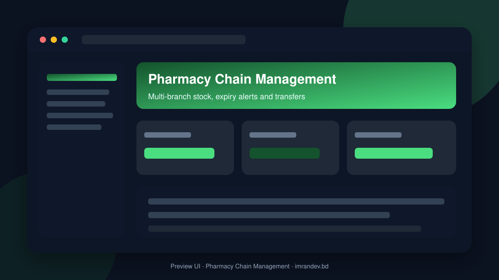
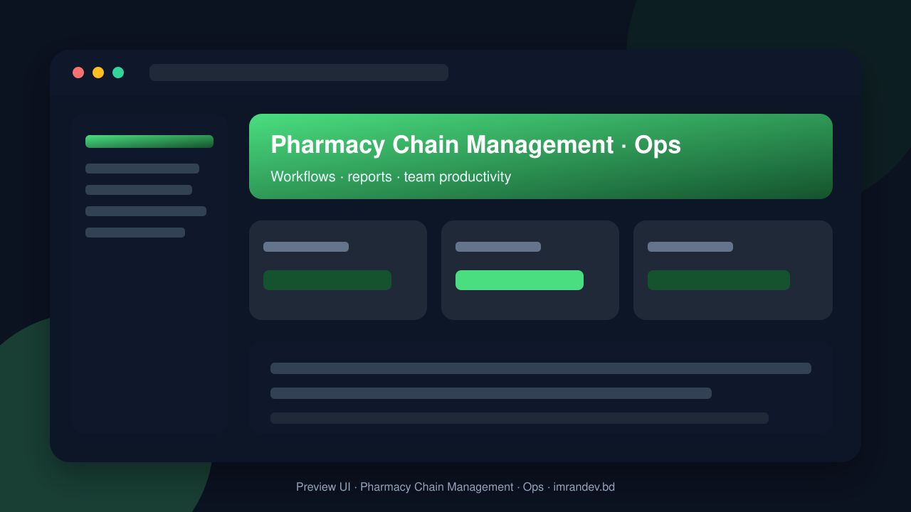

<p align="center">
  
</p>

# Pharmacy Chain Management

<p align="center"><strong>Multi-branch stock, expiry alerts and transfers</strong></p>

<p align="center">
  <a href="https://github.com/imranbru99/pharmacy-chain-management-stock-expiry"></a>
  
  
</p>

---

## Overview

**Pharmacy Chain Management** — Multi-branch stock, expiry alerts and transfers.

This README documents the **real application features** so GitHub and Google visitors can understand what the product does.

## Product screenshots

| Dashboard | Operations |
| :---: | :---: |
|  |  |

## Application features

### Pharmacy chain management

- Multi-branch medicine inventory
- Batch / expiry tracking and near-expiry alerts
- Inter-branch stock transfers
- POS sales and prescription workflows
- Supplier purchasing and GRN
- Controlled substance logs where required
- Customer profiles and loyalty hooks
- Branch performance and stock valuation reports

### Implemented application modules

- Ai
- Billing
- Catalog
- Cms
- Compliance
- Core
- Customers
- Delivery
- Expiry
- Finance
- Forecasting
- Hr
- Loyalty
- Notifications
- Online Orders
- Pos
- Prescriptions
- Purchasing
- Reports
- Sales
- Stock
- Stock Counts
- Suppliers
- Transfers
- Users

### Admin screens (Filament resources)

- Account management
- Cms Page management
- Cms Post management
- Cold Chain Log management
- Controlled Drug Log management
- Customer management
- Delivery management
- Drug License management
- Employee management
- Expense management
- Goods Receipt management
- Journal Entry management
- Leave Request management
- Online Order management
- Payroll Run management
- Platform Invoice management
- Pos Shift management
- Prescription management
- Product management
- Product Recall management
- Purchase Order management
- Purchase Requisition management
- Sale management
- Stock Batch management
- Stock Count management
- Stock Transfer management
- Subscription management
- Supplier management

### Domain data models

- Branch
- Plan
- Tenant
- Tenant Module

## Tech stack

- PHP 8.2+ / Laravel
- Filament admin (where enabled)
- Migrations, seeders, queues
- Vite asset pipeline
- MySQL / SQLite ready

## Quick start

```bash
git clone https://github.com/imranbru99/pharmacy-chain-management-stock-expiry.git
cd pharmacy-chain-management-stock-expiry
composer install
cp .env.example .env
php artisan key:generate
php artisan migrate --seed
npm install && npm run build
php artisan serve
```

## Author

**Imran Ahmed** · https://imrandev.bd · me@imrandev.bd  
GitHub: https://github.com/imranbru99/pharmacy-chain-management-stock-expiry

---
## 🤝 Let's Connect & Collaborate

I am open to **Senior Remote Full-Stack Roles**, AI Platform Architecture Contracts, and Enterprise Technical Advisory.

| Channel | Link |
| :--- | :--- |
| Portfolio | https://imrandev.bd |
| GitHub | https://github.com/imranbru99 |
| LinkedIn | https://linkedin.com/in/imranbru99 |
| Email | me@imrandev.bd |
| WhatsApp | https://wa.me/8801576918420 |
| Packagist | https://packagist.org/packages/imrandevbd/ |

